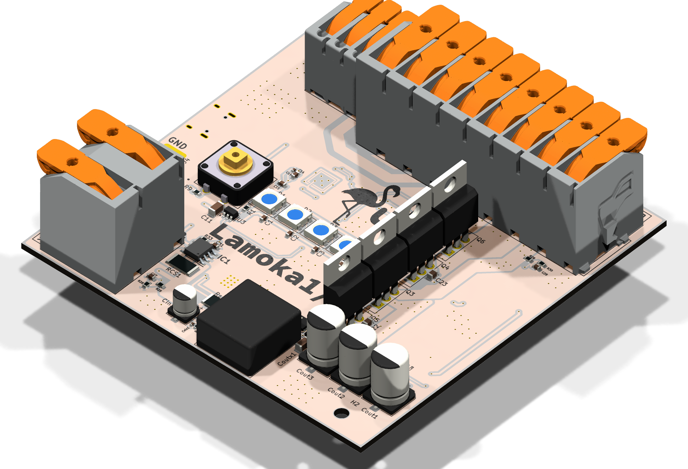

<h1 align="center">
  
   
  Lamoka1/2
</h1>

  PIE v1.9 works on this board.
  For more information on PIE, go
  <a href="SOFTWARE/README.md">here</a>.

  <a href="https://htmlpreview.github.io/?https://raw.githubusercontent.com/bearjhartjen/Lamoka1-half/master/HARDWARE/Kicadfiles/Lamoka1-half/BOM/ibom.html">
    <strong>View Interactive BOM</strong>
  </a>

---
